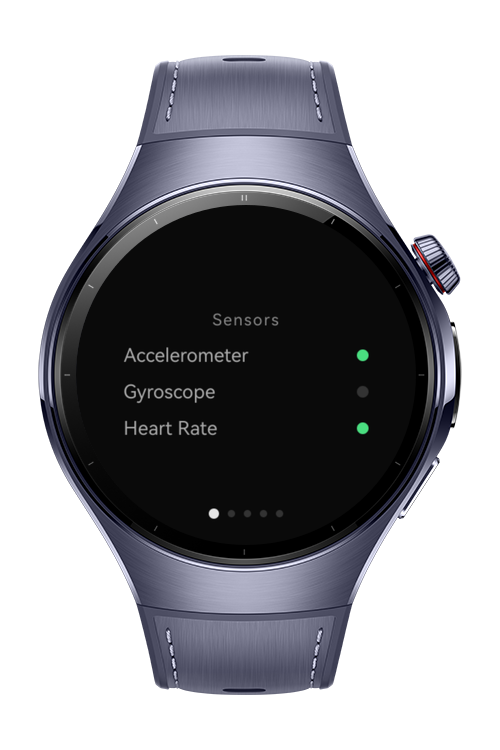
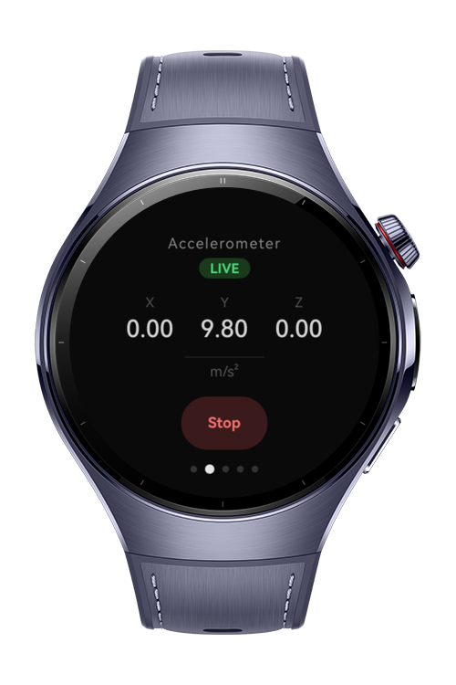
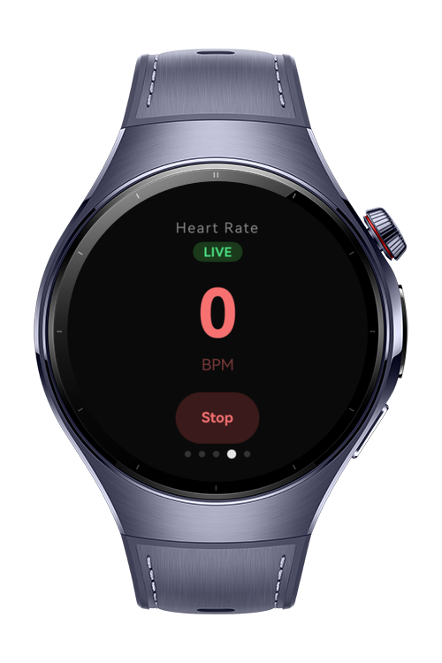
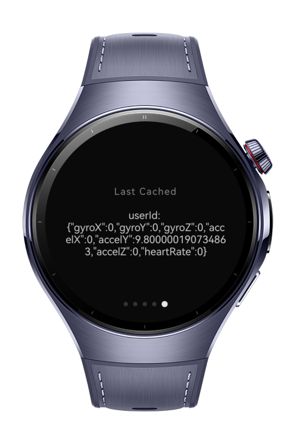

> **Note:** To access all shared projects, get information about environment setup, and view other guides, please visit [Explore-In-HMOS Index](https://github.com/Explore-In-HMOS/hmos-index).

# How To Build Concurrent LRU Cache

This application is a wearable sensor monitoring demo built with ArkTS. It displays live accelerometer, gyroscope, heart rate, and cached sensor values through a swipeable interface. The app uses `SendableLruCache` to store recent sensor data, `ArkTSUtils.locks` to protect shared data during concurrent access, and `ArkTSUtils.ASON` to efficiently serialize structured sensor objects between workers.

# Preview

<div>
    
    
    
    
</div>

# Use Cases

* Users can view live accelerometer, gyroscope, and heart rate values directly from the wearable device.
* Each sensor can be started or stopped separately, allowing users to test individual sensor streams without running the entire system.
* Sensor data is collected through separate worker threads, demonstrating how background tasks can handle live sensor updates without blocking the UI.
* The latest sensor readings are periodically stored in a shared cache, showing how sensor data can be safely updated and accessed in a concurrent environment.
* Users can view the current cached snapshot to understand what sensor values are stored and how the cache updates over time.
* The app can be used to test how wearable devices handle multiple active sensors, worker communication, and frequent cache updates.

# Technology

## Stack
- ArkTS on HarmonyOS NEXT (Stage Model)
- `ArkTSUtils`
- `@kit.SensorServiceKit`
- `@ohos.worker`

## Required Permissions
- `ohos.permission.ACTIVITY_MOTION`
- `ohos.permission.ACCELEROMETER`
- `ohos.permission.READ_HEALTH_DATA`
- `ohos.permission.GYROSCOPE`

# Directory Structure
````
ets/
├── entryability/
│   └── EntryAbility.ets
├── entrybackupability/
│   └── EntryBackupAbility.ets
├── models/
│   └── SensorModel.ets
├── pages/
│   └── Index.ets
├── viewmodels/
│   └── SensorViewModel.ets
├── views/
│   ├── components/
│   │   ├── PageDots.ets
│   │   └── StatusBadge.ets
│   └── sensors/
│       ├── AxisPage.ets
│       ├── HeartRatePage.ets
│       ├── CachedValuePage.ets
│       └── StatusPage.ets
└── workers/
    ├── AccelereometerWorker.ets
    ├── GyroscopeWorker.ets
    └── HeartRateWorker.ets
````

# Constraints and Restrictions

## Supported Devices

- Huawei Watch 5
- DevEco Studio Simulator

# License

how-to-build-concurrent-lru-cache is distributed under the terms of the MIT License. See the [LICENSE](/LICENSE) for more information.